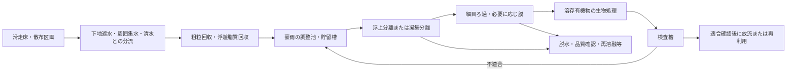

# 脂質の霧雪（S1）とPCLの綿雪（S2）：水質・生分解を優先した独立評価
2026-10-26 / Codex / **当該材料の試作・実測0件。成功確率は算定しない。**

## 0. 判定と適用範囲

**S1を先行する閉鎖試験候補、S2を比較候補とする。どちらも屋外散布・営業使用を認める段階ではない。** S1には脂質粒を冷却固化させる経路があり、S2には溶融紡糸の経路がある。しかし、雪に似た粒子集合体、30分以内の強度回復、50℃での低摩擦、水質保全と環境中の分解を同時に満たした実物はまだない。

新しい依頼者判断に従い、脂肪酸・ワックスそのものの粒と融解膜、及び生分解するPCLは候補に含める。「油だから禁止」「合成高分子だから一律禁止」という以前の除外理由は適用しない。ただし、**生分解は流出許可ではない。酸素消費、浮遊粒、河床への蓄積、添加剤の影響を合わせて合否判定する。** 苦情が出ないことを机上で保証する数値はない。

評価対象：
- [回覧板・依頼者要件の正本](https://github.com/serimu-yamamoto/jinkoukousetu-docs/blob/main/回覧板.md) 第3章、2026-10-26の判断。
- [Claude原案](https://github.com/serimu-yamamoto/jinkoukousetu-docs/blob/main/バーチャル試験/噴霧で雪を作る物質_原点再検証_20261026.md)。
- 読取基準コミット：`86e1971c7dc480b10f2d3010b47c1890e9a2527a`。

記号：**〔一次〕**出典で確認した別試料の知見、**〔算〕**明示した入力による条件付き計算、**〔提案・未確認〕**当該材料で未検証の配合・試験条件・合否値・費用。別試料の結果を本材料の実測へ移さない。数値に合わせる最適化・逆算配合は実施していない。

原案S1の脂肪酸／脂肪アルコールの比率、S2のPCL銘柄・分子量・繊維長は未定である。そのため、**年間流出量・BOD5・生分解半減期・再結合時間・摩擦係数の実物値はいずれも未確認**。以下はこの不足を隠さず、比較と試験に使える形へ直したもの。

## 1. 1haからの年間流出量と水質負荷

### 1.1 量の定義と独立した感度計算

〔算〕面積A=10,000m²、床厚H=0.45m、かさ密度ρb=500kg/m³なら、初期在庫M=A H ρb=**2,250t**。床厚は既存450mm案からの比較用、密度500は原案のモデル値であり、製造できた密度ではない。S1/S2とも同じ在庫で比較する。300mm、500mmならそれぞれ1,500t、2,500tへ比例する。

以下の年間流出率r=0.1%、1%、5%は**予測でも測定値でもなく、未確認の感度条件**。旧Capillo-Firnの年間摩耗60%を脂質／PCLへ流用しない。ここでは「在庫から排水系に入る総材料量」をM rと定義する。スキーへの付着持出し、風で集水域外へ飛ぶ量、保管・噴霧損失、現地で分解する量は別計上する。

年降雨P=2m、流出係数C=0.8を比較用仮定とすればQ=A P C=**16,000m³/年**。所在地・実流量は未確認。1haは水平投影の集水面積として計算した。実際の斜面面積との換算、雪解け水、外部流入、回収水は現場で別途収支を閉じる。

| 排水系への年間流出率r〔未確認〕 | 総材料量 | S1の脂質量※ | S2のPCL量※ | 無処理の材料濃度Cmat |
|---|---:|---:|---:|---:|
| 0.1% | 2.25t/年 | 2.14t/年 | 2.25t/年 | 140.6mg/L |
| 1% | 22.5t/年 | 21.38t/年 | 22.5t/年 | 1,406mg/L |
| 5% | 112.5t/年 | 106.88t/年 | 112.5t/年 | 7,031mg/L |

※S1は比較用に脂質95質量%＋無機分5%、S2はPCL100%。実際の組成・流出時の成分分級は未確認。Cmat=流出kg×1,000/Q。全部が測定用フィルターに捕捉されるなら材料由来SSの上限側の目安になるが、**浮上油、溶存有機物、極細片はSSと同一ではない**。SSだけを測って回収率を出さず、油分・TOC・粒子／繊維数・総質量を併測する。

### 1.2 BOD5を理論酸素要求量と混同しない

炭素・水素・酸素だけの有機物CₐHᵦO꜀について、完全酸化に必要な酸素は(a+b/4−c/2)mol-O₂/mol。これは反応式の量論であり、5日間に微生物が消費する量ではない。

| 純物質・繰返し単位 | 理論酸素要求量ThOD〔算〕 |
|---|---:|
| パルミチン酸 C16H32O2 | 2.870kg-O₂/kg |
| ステアリン酸 C18H36O2 | 2.924kg-O₂/kg |
| ベヘニルアルコール C22H46O | 3.233kg-O₂/kg |
| PCL繰返し単位 C6H10O2 | 2.102kg-O₂/kg |

化学式・PCLの繰返し構造は[S1][S3]。末端基、可塑剤、不純物が多い低分子品は別途補正する。無機分を除いた流出有機物濃度をCorgとすると、概念上 **BOD5=Corg×ThOD×f5**。f5は当該排水の5日間酸素消費割合で、**未確認**。COD分析値もThODと同一ではない。

S1をパルミチン酸相当95%、S2を純PCLとして前表に適用すると：

| r | S1のThOD負荷濃度 | S2のThOD負荷濃度 |
|---|---:|---:|
| 0.1% | 383mg-O₂/L | 296mg-O₂/L |
| 1% | 3,834mg-O₂/L | 2,957mg-O₂/L |
| 5% | 19,171mg-O₂/L | 14,783mg-O₂/L |

例えばr=1%、仮にf5=0.1ならBOD5はS1約383、S2約296mg/L、f5=0.5なら約1,917／1,478mg/L。**f5=0.1、0.5は感度例で、PCLが5日でその割合まで分解するという主張ではない。** 年平均濃度は初期流出・豪雨のピークを保証しない。

1tの純脂質／PCLが最終的に完全酸化されれば、それぞれ約2.9t／2.1tの酸素需要になる。速い生分解は残留時間を短くする一方、河川内で起きれば酸素を急に奪い得る。**分解は回収後の管理設備で進め、河川の自浄作用を処理設備として数えない。**

### 1.3 高い回収率でも残留量はゼロにならない

r=1%＝22.5t/年を排水系へ運ぶ比較条件。下表ηは材料の総回収率で、設備性能として未確認。

| η | 未処理バイパス※ | 山外へ出る総材料 | Cmat | S1/PCLの残留ThOD |
|---|---:|---:|---:|---:|
| 95% | 0 | 1,125kg/年 | 70.31mg/L | 191.7 / 147.8mg/L |
| 99% | 0 | 225kg/年 | 14.06mg/L | 38.34 / 29.57mg/L |
| 99.9% | 0 | 22.5kg/年 | 1.406mg/L | 3.83 / 2.96mg/L |
| 99.9% | 1% | 247.3kg/年 | 15.45mg/L | 42.14 / 32.49mg/L |

※バイパス率bは**材料負荷の割合**。水量の割合と同じとは限らない。流出=M r{b+(1−b)(1−η)}。豪雨越流・フィルター破損・停電を除外した99.9%では年間評価にならない。分離した汚泥・回収油をそのまま山に戻すことも回収完了ではない。

## 2. 河川・土中でどれくらい速く分解するか

| 対象と一次研究 | 確認できた時間・結果 | 本件への限界 |
|---|---|---|
| ステアリン酸、Ward 1985 [S2] | 浄化槽浸透処理域の好気性土壌で、14CO₂発生による半減期：表層118時間＝4.92日、下層82–312時間＝3.42–13.0日 | 特定の処理域土壌の試験。日本の山林、低温土壌、脂質粒の堆積層、混合ワックスに同じ値を使えない。抄録で試験温度・添加濃度を確定できず、それらは未確認 |
| S1の完成配合、現地河川／現地土壌 | **半減期・完全分解までの日数とも未確認** | 脂肪酸を「食べられる」「自然界に存在する」と説明しても、流出量に見合う分解・無害性の証明にはならない |
| PCL、Bagheriら2017 [S3] | 320±20µm厚フィルム、25℃、人工海水・淡水を模した条件、2週ごと換水。1年間、有意な分解を認めなかった | 重量等による評価。自然河川すべてで不分解という証明ではない。細繊維は比表面積が違うが、速さを換算する係数は未確認 |
| PCLの土壌試験、Modelliら1999 [S4] | 粉末のCO₂発生を測定し、露出表面積に依存するモデルを報告 | 原論文公開抄録では分解百分率・日数を確認できない。二次資料の「22℃・270日で約100%」を本監査の確定数値には採用しない |
| PCL繊維、Irizarら2018 [S5] | 電界紡糸繊維を汚泥・3土壌で最大180日評価。条件・被覆に依存し、汚水処理での分解は部分的 | メルトブロー品ではない。確認できた一次抄録に土壌別の分解率がないため、その数値と半減期は未確認 |
| PCL/TPS、2020年の原著研究 [S6] | 25℃土壌、CO₂測定。純PCLとデンプン混合物では分解挙動が異なり、混合物では先にデンプン相が失われる | デンプンの消失をPCL全体の分解と数えない。58℃堆肥化結果を河川の結果に転用しない |

**結論：S1は土壌で日単位の鉱化例があるが、完成配合の河川内分解速度は未確認。S2は淡水で年単位の残留を否定できず、「すぐ消える綿雪」として採用できない。** 「PCLなら不可」という意味ではなく、**採用銘柄・添加剤を含む完成繊維について、生分解が利用環境で成立するかが未判定**という意味である。

脂質について、データベース等に転記されるパルミチン酸「29日で536→3.7µg/L、半減期0.5日」は採用しない。両端点に単一指数減衰を仮定すると半減期は約4.04日となり、0.5日とは一致しない。元研究の時系列・相分配を未確認のまま、都合のよい半減期を選べない。これを現地予測にも使わない。

生分解の測定は、重量減少だけでなく、酸素消費またはCO₂生成、溶存有機炭素、残留粒子・繊維を組み合わせる。粉砕・溶出・容器壁への付着は、鉱化ではない。ISO14851は**活性汚泥を接種した水系試験**、ISO17556は土壌の水分等を調整した試験であり、規格名だけで実河川の速度は決まらない。[S7]

## 3. 麓へ影響を出さないための構成と費用

### 3.1 沈砂池だけでは成立しない

提案する処理系列は次のとおり。各除去率は未確認で、実排水で検証する。

- **S1**：脂質は鉱物砂と同じ沈降挙動ではない。密度、空気抱込み、乳化、固液状態によって浮上する。油を表面から集めるスキマー、必要に応じ浮上分離を設ける。界面活性剤で流しやすくすると溶存／乳化成分が増えるため、回収試験をやり直す。
- **S2**：PCL真密度は別試料で1.145g/cm³ [S8]。それでも微細繊維の形状・付着気泡で沈降が遅れる。球の沈降計算だけで沈砂池を設計しない。細目スクリーン、ろ過、逆洗水回収を組み合わせる。
- 生物処理前にできるだけ固形物を回収する。大部分を水中で生分解させる設計は、曝気、汚泥、臭気管理を大きくする。難分解な残留PCLを活性汚泥設備へ送るだけでは処理完了にならない。
- ろ材・スキマー・下地材は滑走面として露出させない。冬季に油状弱面、水の滞留、凍結閉塞を作らない構造を別に確認する。

### 3.2 豪雨時の容量

〔算・未確認の設計降雨〕100mm/h、1ha、流出係数1なら**1,000m³/h**。20m³/hの処理装置で受けると、1時間で**980m³**、6時間なら**5,880m³**の未処理水がたまる。1,000m³を20m³/hで処理するには50時間必要。100mm/hの10分間だけで約167m³になる。

したがって、**従来の150m³ピットだけでは、この条件の1時間降雨を保持できない**。1,000m³級貯留は以下の概算用の1時間条件であって、台風対策の完成設計ではない。連続雨、既存貯水、停電、越流経路、冬季排水を含む現場設計雨量で容量を決める。

### 3.3 費用の目安

〔一次〕環境省ETVの2017年報告には、厨房油水分離＋SS回収装置の費用**1,211万円**が記載される。実証施設の過去水量は19m³/日、30µmネット等を使用。[S9] これは**当該候補粒子の捕集性能でも、20m³/h設備の見積でも、現在価格でもない**。雨水処理装置を数十万円だけで成立させる想定を避ける参考例である。

以下は、1ha・20m³/h処理・約1,000m³貯留の比較検討用枠。**すべて〔提案・未確認〕、業者見積なし、税抜、2026年の価格として裏付け未確認。ETV価格を倍率で拡張して作った見積ではない。**

| 新設する範囲 | 概算枠 |
|---|---:|
| 外水分流、集水、下地遮水・配管 | 1,500–4,000万円 |
| 約1,000m³貯留、掘削、防水、ポンプ | 3,000–8,000万円 |
| 粗粒・浮上物回収、スクリーン、脱水 | 1,000–2,500万円 |
| 浮上／ろ過、生物処理、逆洗水の回収 | 2,000–5,000万円 |
| 計測、制御、検査槽、設計・試運転 | 500–1,500万円 |
| 小計／予備費20%込み〔算〕 | **8,000–21,000万円／9,600–25,200万円** |

年間は、電力60–140、薬剤・ろ材50–200、汚泥・回収物処分100–400、保守120–300、分析100–250、運転労務100–300万円を置くと、**530–1,590万円/年〔未確認〕**。有機物の負荷、排水量、回収率、再利用可否で大きく変わる。これは営業人件費、粒子補充費、整地設備費とは別。数百g試験の価格でもない。

土地取得、支持地盤・擁壁、既設管改築、法面防災、6時間豪雨を保持する追加貯留、再造粒／紡糸設備はこの枠に含まない。既存の集水・貯留・処理が使えれば減額できるが、能力は未確認。**水処理込みで2億円以内と約束する根拠は現時点でない。** 回収できる材料設計と既存設備の活用を先に確認し、材料費を含む全体事業費を分けて比較する。

## 4. 噴霧・再結合・摩擦・硬さ・燃焼の見込み

### (a) 飛行中に固まるか

**S1：小滴の放熱は速くできる。ただし結晶化、形、捕集の三つを別に確認する。** 溶融噴霧で主に得られるのは球状・不定形の滴であり、内部が結晶でも雪の樹枝状形態にはならない。雪らしい集合体は、冷えた一次粒の疎な凝集・接点の形成として検討する。

〔算〕球滴の集中定数モデルで、放射・核生成待ち・過冷却を省いた放熱時間：
`t=ρd²/(6 Nu k_air) × {cp ln[(T0−Ta)/(Tc−Ta)] + L/(Tc−Ta)}`。
Tcは凝固温度。**Tc≤Taならこの冷却経路では凝固させられない。**

パルミチン酸のNIST収録値53.9kJ/mol、335.4Kを換算すると、L≈210.2kJ/kg、62.25℃ [S1]。ただし融点を凝固温度に置いたのは**過冷却なしの仮定**。比較入力はT0=75℃、ρ=900kg/m³、cp=2,400J/(kg K)、空気熱伝導率0.027W/(m K)、Nu=2。ρ・cp等は今回滴の実測ではなく**未確認のモデル入力**。

| 仮のTc／空気温度 | 直径20µm | 50µm | 80µm |
|---|---:|---:|---:|
| 62.25℃／35℃ | 9.6ms | 60ms | 154ms |
| 62.25℃／50℃ | 21ms | 131ms | 335ms |
| 55℃／35℃ | 14ms | 85ms | 216ms |
| 55℃／50℃ | 51ms | 319ms | 816ms |

55℃行は**同じ仮の熱物性でTcだけを変えた感度計算**であり、実在する共晶配合の予測ではない。強制対流は短縮方向、噴流の加熱、内部温度差、核生成待ちは延長方向に働く。したがって「20–80µmなら必ず数msで雪になる」とは判定できない。

さらに、微細化は回収を難しくする。ρ=900、空気粘度1.9×10⁻⁵Pa sの静穏空気・球・終末沈降という仮定で、20／50／80µmの沈降速度は約0.010／0.065／0.165m/s。1m落下中に横風2m/sがあれば、単純計算の横移動は約194／31／12m。噴流・乱流を省き、80µmではStokes近似にも誤差があるため実飛距離ではないが、**開放散布に移る根拠にはならない**。まず回収フード付き閉鎖噴霧で評価する。

**S2：細繊維化は候補だが、35–50℃空気中の即時固化は未確認。** 高分子PCLの一次研究では、緩い冷却の結晶化が44℃付近で始まり39℃でピーク、34℃付近で終わった。45℃の結晶成長を1,800秒・3,600秒で観察している。[S8] 銘柄・冷却・延伸で変わるが、融点60℃を下回っただけで瞬時に固い繊維になるとは言えない。熱風紡糸では噴出空気自体が熱く、冷却区間を別に要する。

PCLには専用の溶融紡糸／メルトブロー機を使う。S1用の二流体ノズルをそのまま共用できるという原案は未確認。連続した不織布・シートを作れば滑走面の必須要件に反するため、**独立した短繊維集合粒として回収できるか**を先に判定する。

### (b) 30–50℃で自然にくっつき直す時間

**S1・S2とも、30分、1時間、4時間などの確定時間は出せない。** 相同温度T/Tm≈0.9以上は候補探索の指標であり、時間を決める拡散係数、粘度、粒の寸法、接触荷重、接点表面の状態が欠けている。

液体球を粘性焼結させる初期モデルでは、接点比(x/R)²の成長尺度はγt/(ηR)になるが、結晶粒を融点未満に置いたまま、この液体モデルのηを自由に設定して30分へ合わせない。PCLの前述の「結晶化30–60分」は、**既に固まった粒の再接着時間ではない**。

30／40／50℃で、破壊・標準再圧縮後の0、5、15、30、60分、4時間、24時間のせん断と剥離を測る。昼60分閉鎖を維持する案では、整地・安全確認の時間も必要なので、当面の回復判定点は30分とする。30分を超える場合、夜間整備へ逃がして昼の要件を達成したことにはしない。

### (c) 摩擦熱の融解でμ≤0.10になるか

**どちらも未確認。S1は優先して調べる価値があり、S2は粘着・糸引きの可能性をより厳しく見る。**

〔算〕見かけ圧20kPa、速度10m/s、接触長1m、診断用μ=0.05を置くと、単位面積の摩擦仕事は
`E=μpv(Lc/v)=μpLc=1,000J/m²`。
これが全てパルミチン酸相当材の加熱・融解に入る極端な上限なら、30℃からの融解厚は約4.0µm、50℃からなら約4.7µm。実際は板側・固体内部へ熱が逃げる。**μ=0.05は仮入力であり、この計算から低摩擦を証明すると循環論法になる。**

融液が存在することと、摩擦が低いことも別。全面が厚さ10µmの液膜でせん断される単純Couette流では、
`μfilm=ηv/(p h)`。
同じp、vで、仮の粘度η=0.005／1／1,000Pa sなら、μfilm=0.25／50／50,000。これらは実際の摩擦予測ではなく、**融ければ必ず滑るという主張への診断例**である。部分接触、すべり、せん断薄化、膜切れで変わる。

メーカーの旧CAPA6500資料には、70℃・せん断速度10s⁻¹で粘度2,890Pa sが記載される。[S10] 高速接点へその値を外挿できないが、水のような低粘度融液ではないことは分かる。現メーカーも粘着付与・接着用途を示す。[S11] PCLの液膜厚や荷重分担を逆算で選びμ≤0.10へ合わせない。

測定は無添加UHMWPEを使い、30／40／50℃、乾燥・降雨後、低速と高速で行う。摩擦、接点温度、板への転写膜、摩耗量、粒の巻込みを同時に記録する。平均μだけでなく、停止・再始動時の貼付きと急な摩擦増加も判定する。

### (d) 硬さと燃えやすさを下げる配合

**「雪の約8倍」は確定物性ではない。** 既存コードには、未測定の結合強度・充填・含浸率を置く部分や、必要強度に向けて値を選ぶ枝がある。過去の1.05倍切削抵抗や24–37kPaも実証値として採用しない。新しい噴霧粒にそのまま引き継げない。

最初の比較配合は以下とする。**完成配合の推奨ではなく、原因を分離する〔提案・未確認〕の小試験系列**。CaCO₃は原案の候補を検証するためで、無害・難燃・低摩耗を保証した採用ではない。

| 系列 | 100g換算の基準／比較 | 調べること |
|---|---|---|
| S1-R基準 | 純パルミチン酸100g | 未特定共晶を避けて噴霧、融解、凝集、板への付着を分離 |
| S1-5／10 | パルミチン酸95g＋CaCO₃ 5g／90g＋10g | 原案の核剤・白色粉が固化、燃焼、硬さ、排水へ与える影響 |
| S2-R基準 | 銘柄固定の無添加PCL100g | 繊維化、固化、凝集、転写、全成分の分解 |
| S2-5／10 | 同PCL95g＋CaCO₃ 5g／90g＋10g | 不燃分追加の効果と、紡糸不良・硬化・鉱物粉流出の増加 |

純パルミチン酸基準は、原案の「52–62℃共晶」を製造したという意味ではない。共晶の低融点化は次の探索枝として残すが、**軟化を狙う混合で50℃保持が失われないかDSCを先に確認する**。添加剤を増やすたび、生分解・水質試験も完成配合でやり直す。

特に脂肪酸とCaCO₃は化学的に常に不活性とは限らない。中和が完了すれば
`CaCO3+2RCOOH→Ca(RCOO)2+CO2+H2O`。
5gのCaCO₃はパルミチン酸約25.6gを反応させ得る量論容量を持つ。**今回条件で実際に反応する速さは未確認**。発泡、酸価、生成Ca石けんを確認してからノズルへ送る。不燃水酸化物も酸との反応確認なしに追加しない。

硬さを下げる第一の設計変数は、固体そのものを軟らかくすることだけでなく、疎な集合粒と小さな接点である。PCLも太い固まりより短繊維集合体を比較する。ただし、繊維を長くして綿の引きずり・絡まりを増やせば雪の破断感から離れる。形状改善は燃焼性改善と独立して測る。

〔一次〕PCLの微小燃焼熱量測定（ASTM D7309）で総発熱量26.45MJ/kgの報告がある。[S12] 単純に不燃粉10%で希釈しても**約23.81MJ/kg〔算〕**が残る。着火、延焼、溶融滴下はこの比例計算から決まらない。脂肪酸も可燃性である。[S13] **5–10%の鉱物添加だけで安全なゲレンデ火災性能を得たとは言えない。** 難燃性の判定には熱放出・延焼・滴下の実測が必要で、白さや生分解性では代用しない。

## 5. 1案450gの閉鎖試験案と事前合否

### 5.1 実施前に固定するもの

実物試験は今回実行していない。設備・協力先の確保、材料の購入・発注もしていない。以下を試験所へ渡す仕様案とする。

1. S1は純度・不純物・酸価・粒径、S2は製品名・ロット・分子量分布・MFR・全添加剤・残留触媒を記録する。CASや「食品／医療用」表示だけで環境安全を認定しない。
2. DSCで昇温・冷却曲線、50℃等温保持、結晶化の遅れを先に測る。S1とCaCO₃の比較試料は、密閉加熱せず、反応・発泡・融点変化を少量で確認する。反応が見られる場合は配合を別物として再登録する。
3. 装置の加工温度・圧力・流量は、採用材料の実測粘度と装置定格で試験所が固定する。原案に値がなく、ここで架空の噴霧圧やPCL加工温度を確定しない。温度・圧力記録なしの試料は比較に用いない。
4. 回収フィルター、周囲拭取り、装置残留を含む質量収支を先に校正する。微細な可燃性の粉・溶融ミストを扱える排気・防着火・温度過昇防止設備を持つ試験所に限定する。家庭での裸火・開放噴霧は試験手順にしない。

### 5.2 試料量と順序

各案**450g**：基準材300gを独立した100g仕込み×3回、5%CaCO₃比較材50g、10%比較材50g、未加工対照50g。比較材50gの内訳は47.5+2.5g／45+5g。S1・S2各450g、合計900g。**原案の未特定共晶をこの仕込みで確定したと扱わない。**

最初の300gで、製造可能性・温度保持・短距離摩擦・再結合を選別する。比較材は基準が製造できてから、DSC・熱量・微小硬さへの影響を見る。立上げにこれ以上の量を要する機械の場合は、この計画で実施可能とは扱わず、装置と必要量を見直す。450gだけで実スキーの速度・全床強度・火災・年間水質を一括証明しない。

- **形成**：S1は加熱二流体ノズル、S2は溶融紡糸機。35℃の回収空間で噴出直後と複数距離を観察し、到達時間、粒径／繊維径、着地時温度、固化、自由粒か連続ウェブかを記録。冷却補助が要るなら、補助温度・エネルギーを記載し「夏の外気だけで固まった」としない。
- **保持・凝集**：回収材を30／40／50℃で8時間保持。非圧縮試料の固まりと、再圧縮後の強度を区別する。50℃で流れた液、板へ移った材料は回収して秤量する。
- **感触の小選別**：小型UHMWPE接触子で20kPaを基準に、0.1、1、5m/s、可能なら10m/sを比較する。実施できない速度は未試験とする。温度別・乾燥／水接触後の摩擦を測る。自然圧雪は適切な氷点下環境で同一形状・載荷・測定法の対照を作り、35℃へ置いて融かした雪を対照にしない。
- **再結合**：同じ圧縮履歴と破壊履歴を与えた小型セルを使い、4(b)の時点で測る。応力・変位・破壊後の抵抗を保存する。小型セルの壁摩擦・試料寸法の影響を確認し、1条件1試料の結果を全床強度へ外挿しない。
- **雨と回収**：未摩耗材と短距離摩耗後材を分け、既知面積トレーに100mm/h相当の雨を1時間与える条件を提案。10×10cmなら1L。試験量の制約で床を薄くした場合、450mm床を再現したとは扱わない。流出物を浮上・沈降・ろ過・溶存へ分け、原水と模擬処理後のpH、BOD5、COD、TOC、SS、油分、粒子数を測る。採水量不足を後から希釈して改善したように見せない。
- **生分解**：原料、完成粒、摩耗粉を区別。水系はISO14851等の比較試験に加え現地淡水・底質、土壌はISO17556を参考に現地土壌で試験する。[S7] 季節の温度履歴、非馴化微生物、無菌対照、基質なし対照、正の対照を設ける。加温・菌添加で得た結果は現地条件と分ける。
- **硬さ・燃焼**：同じ方法の圧雪対照に対する貫入・切削を測る。燃焼は認定能力のある試験所で微小燃焼熱量をまず選別し、通過後に、床のかさ密度・通気・傾斜を再現した延焼・滴下試験へ進む。

### 5.3 第1門：少量試験を次段階へ送る暫定基準

**下表は事前登録用の〔提案・未確認〕。天然雪との同等性を保証する既成規格値ではない。** μ≤0.10、30–50℃、60分閉鎖等の依頼者要件と、試験管理用の暫定値を区別した。各値は測定後に変更せず、変更時は別版・別試料として理由を公開する。

| 項目 | 暫定合否 | 根拠と制約 |
|---|---|---|
| 計量の妥当性 | 回収物＋装置残留＋排気捕集の質量収支95–105% | 測定品質の自主基準・未確認。収支が閉じなければ環境捕集率は不判定 |
| 形成 | 着地回収質量の95%以上が固体として独立操作できる。連続シート・網状ウェブは不合格 | 95%は工程選別用の未確認値。内部結晶化はDSC／顕微鏡で別測定 |
| 50℃保持 | 8時間で自由液の漏出が初期質量の1%以下、トレー全体が一枚の固まりにならない | 1%は微小試験用の未確認値で、環境へ1%流してよい意味ではない |
| 摩擦 | 各試験条件で平均＋測定の拡張不確かさがμ≤0.10。貼付き・引きずりによる継続不能は不合格 | 上限は依頼者目標。未試験の速度／湿潤条件は合格扱いしない |
| 圧雪らしい硬さ・切削 | 同一測定法の自然圧雪比0.5–1.5、目標かさ密度400–550kg/m³ | 比率は既存設計の暫定帯・同等感の保証として未確認。原料のShore硬度を圧雪床の貫入硬さと比較しない |
| 30分回復 | 仮の一面せん断条件σn=50kPaでSf≥40kPa、かつ同条件の圧雪対照の0.5–1.5倍 | 40kPa・比率は既存案からの暫定値で未確認。接着だけ強くても延性・糸引きが大きければ感触を不合格 |
| 粒子の再利用 | 3回の再加熱／再成形後も、上記の温度保持・摩擦を満たす | 3回は初期選別の未確認条件。年間耐久性の証明ではない |
| 燃焼改善材 | 基準材比で単位質量の総発熱量が添加量に応じ減少し、着火・滴下・発熱ピークを悪化させない | 配合比較用。10%希釈のみでは屋外火災合格にならない。屋外の安全な数値基準は未確認、専門評価を終えるまで屋外不可 |

### 5.4 最終門：水質・生分解による屋外使用の判定

**少量噴霧の合格だけではこの門を通らない。** 法令の排水上限と「麓へ影響を出さない」ことを同一視しない。

〔一次〕国の一般排水基準は、BOD/COD160（日間平均120）mg/L、SS200（日間平均150）mg/L、動植物油脂類のn-ヘキサン抽出物30mg/L等。[S14] 施設・排水・自治体の上乗せ等により適用を確認する。脂肪酸混合物やPCLを自動的に「動植物油脂30」で扱えるかは未確認。

〔一次〕河川AA類型の目安はBOD≤1mg/L、SS≤25mg/L、pH6.5–8.5、DO≥7.5mg/L。[S15] **これは河川の環境基準で、全排水口の法定基準ではない。** ここでは所在地が未定の間、次の自主設計条件として借りる。

- 処理・検査槽の出口：BOD5≤1mg/L、SS≤25mg/L、pH6.5–8.5、DO≥7.5mg/L。油膜・浮遊粒の目視確認があれば不適合。油分については、分析定量下限を試験前に決め、定量された値と測定誤差を報告する。全国共通の「苦情が出ない油分濃度」は**未確認**。
- さらに受水河川：渇水時流量・既存BOD/DO、豪雨ピーク、底質・下流取水を含む負荷評価と上下流実測で、該当する環境基準等を維持すること。出口適合だけで上流より悪化しないことは保証できない。
- 生分解の初期選別：OECD301に適合する試験では60%ThOD/ThCO₂又は70%DOC等の判定体系がある。[S16] これは易分解性のスクリーニングで、**河川で28日以内に同じ割合が消える保証ではない**。方法ごとの10日窓・有効性要件等を試験所で適用し、単に28日60%だけで規格適合としない。
- 現地条件の最終提案：水系・土壌の双方で、**365日以内に正の対照に対して90%以上の鉱化**を自主目標とし、絶対鉱化率、残留有機炭素、残留粒子量も提出する。365日・90%は本件用の**未確認の暫定設計基準で、日本の法定値でも、ISOの一律合格値でもない**。対照が適切に分解しない試験、混合物の易分解分だけが消えた試験は不成立。365日まで未到達の材料を「そのうち分解する」として屋外採用しない。
- 水生生物：完成材由来の未ろ過流出水と分離後水について、藻類生長、ミジンコ遊泳・繁殖等を段階評価する。環境省が用いるOECD201/202等を参照。[S17] 事前の自主基準は、想定最大曝露の未希釈処理水で成長・繁殖・遊泳等の影響が対照比10%を超えず、その不確かさも評価すること。**10%は当該複合物の無害を保証する公的閾値として未確認**。慢性影響・堆積・添加剤の確認を省略しない。

生分解率、捕集率、処理水質、処理量、事故時越流、費用のうち一つでも未測定のままなら、屋外採用の総合判定は**保留**。これを「不可能」と結論するのではなく、S1-Rの閉鎖製造→水質・摩擦の早期選別→長期生分解→限定区画の順に、最小量で不成立原因を除く計画とする。

## 6. 再現資料・引継ぎ

- [計算結果JSON](S1_S2水質生分解評価_20261026/audit_results.json)
- [計算コード](../計算部品/s1_s2_water_thermal_audit.py)：標準Pythonのみ。質量、酸素量論、回収、滴の放熱、摩擦熱の上限、豪雨貯留、費用の足算を再現する。
- [入力と出典の対応](S1_S2水質生分解評価_20261026/inputs_and_sources.md)

算術チェックは数式・質量収支の確認であり、実物の成功回数ではない。旧モデルの乱数分布や成功率は継承していない。試験前に固定すべき次の値は、**S1の正確な完成配合、PCLの銘柄・全添加剤、噴霧装置の定格、実河川流量・水質、季節水温・土壌、流出全経路、処理性能、業者見積**である。

Claudeへの要点：許可条件の更新で候補の探索範囲は広がった。次は「融点が近いから雪になる」ではなく、**回収可能な自由粒の形成、非粘着低摩擦、温度保持、完成配合の環境中鉱化**を別々に測る。S1/S2の名前を維持しても、中身を変更した場合は旧結果を引き継がず試料IDを更新する。

## 6補足. 保存直前に追加されたGemini・Claude資料との関係

保存前に main の追加コミット `9e9359c1943d7818af377125f352e043abc6ccf4` を確認し、[Gemini全文](https://github.com/serimu-yamamoto/jinkoukousetu-docs/blob/main/GPT往復/Gemini回答_S1脂質_S2PCL_水質生分解・噴霧検証_20261026.md)と[Claude短報](https://github.com/serimu-yamamoto/jinkoukousetu-docs/blob/main/GPT往復/Claude監査_S1S2評価_20261026.md)を参照した。依頼者要件の第3章に変更はない。以下は追加資料との照合であり、本報告の原案評価を、新配合の性能予測へ読み替えない。

- Geminiの追加S1案は脂質48%、Mg(OH)₂ 30%、CaCO₃又は中空シラス20%、ソルビタン脂肪酸エステル2%。本報告の95%脂質という水収支比較、及び0/5/10%の少量フィラー試験とは**別配合**である。脂質の内訳、CaCO₃／中空シラスの選択、乳化剤の銘柄が固定されるまで完成配合は未確定。無機物50%だから同じ体積の床のBODも半分、とは言えない。在庫質量・摩耗・捕集・溶出率も変わる。密度を変えた場合は在庫から再計算する。
- 遊離脂肪酸にMg(OH)₂やCaCO₃を加えると脂肪酸塩への反応経路がある。例えば 2 RCOOH + Mg(OH)₂ → (RCOO)₂Mg + 2 H₂O。これは化学量論であり、80〜85℃・所定時間での反応率は**未確認**。充填材を全量「不活性のまま」とする前提では融点・粘度・溶出・再溶融再生を決められない。乳化剤2%の添加は油水分離を難しくする可能性があり、当該配合での影響は未確認。まず酸価・DSC・凝集／分離性を確認する。
- Claudeの「充填により密度が上がる」「50℃・無荷重の長時間固結を測る」「整地費と水処理費を合算する」という指摘に同意する。本報告では未充填又は少量充填から構造を切り分け、50℃・8時間と豪雨貯留を独立ゲートにした。閉孔30〜40%はまだ得られた構造ではない。
- Geminiの摩擦式に記載の入力をそのまま代入すると、5%面積、粘度0.010Pa·s、面圧20kPa、速度10m/s、膜厚2µmで粘性項0.125。膜厚を5µmにすれば0.050だが、**速度だけ5m/sへ変えれば0.0625**であり0.025〜0.050ではない。膜厚・荷重分担・真実接触面積は同時に測る必要があり、目標摩擦に合う膜厚を選ぶことはしない。摩擦0.05を置いた発熱計算も、0.05になることの証明ではない。
- PCLの粘度・接着性から融解膜案を優先しない判断には同意する。ただし、低せん断の粘度から全銘柄・全条件の「物理的に成立しない」まで断定する根拠は不足する。本報告はS2を比較試料にとどめ、結果が出なければ外す。
- 旧案の摩耗60%、回収80%、水への移行10%、ThODの60%をBOD5とする仮定は新材料の実測ではない。OECD301の28日易分解性を河川での28日消失とみなすこともしない。SS・BOD等の自主基準を満たしても「苦情が確実にない／出る」とは判定できず、現地流量・背景水質・溶存酸素・実配合の生態影響が必要である。

## 7. 一次資料・確認範囲（2026-10-26確認）

以下は当該候補の成功を保証する資料ではない。公開本文、抄録、メーカー資料、規格の公開範囲を区別した。

- **[S1] NIST Chemistry WebBook, n-Hexadecanoic acid**：分子式、分子量、融解エンタルピー53.9kJ/mol・335.4Kの収録。https://webbook.nist.gov/cgi/cbook.cgi?ID=C57103&Mask=4
- **[S2] Ward, 1985, Characterizing the aerobic and anaerobic microbial activities in surface and subsurface soils**：一次論文の公開抄録で14CO₂によるステアリン酸の半減期を確認。試験温度等の未確認部分は本文へ持ち込まない。https://doi.org/10.1002/etc.5620040603
- **[S3] Bagheri et al., 2017, Fate of So-Called Biodegradable Polymers in Seawater and Freshwater**：原著全文。PCLの厚み、25℃、1年、2週ごと換水、重量変化等。https://doi.org/10.1002/gch2.201700048 （公開全文：https://pmc.ncbi.nlm.nih.gov/articles/PMC6607129/ ）
- **[S4] Modelli et al., 1999, Kinetics of Aerobic Polymer Degradation in Soil...**：一次公開抄録のみ。表面積依存とCO₂測定を確認。270日等の数値は本文未確認につき採用しない。https://doi.org/10.1023/A:1021864402395
- **[S5] Irizar et al., 2018, Environmental fate and effect of biodegradable electro-spun scaffolds...**：一次公開抄録。最大180日・3土壌等、条件依存。https://pubmed.ncbi.nlm.nih.gov/29713809/
- **[S6] Structure Characterization and Biodegradation Rate of Poly(ε-caprolactone)/Starch Blends, 2020**：原著全文、25℃土壌と58℃堆肥の区別。https://doi.org/10.3389/fmats.2020.00141
- **[S7] ISO14851:2019／ISO17556:2019**：ISO公開の適用範囲。前者は活性汚泥を用いた水系酸素消費、後者は土壌での酸素消費／CO₂。規格全文の有料部分は購入していない。https://committee.iso.org/standard/70026.html ／ https://committee.iso.org/standard/74993.html
- **[S8] Characterization of the Polycaprolactone Melt Crystallization: Complementary Optical Microscopy, DSC, and AFM Studies, 2014**：原著全文。密度1.145、分子量、冷却条件、45℃の観察時点を確認。https://pmc.ncbi.nlm.nih.gov/articles/PMC3913191/
- **[S9] 環境省ETV、平成28年度・実証番号020-1601、2017年3月**：油水分離・SS回収、概要pp.2–5相当、価格は申請者提示の参考費用。厨房水を対象とし、本件脂質・繊維には未実証。https://www.env.go.jp/policy/etv/pdf/list/h28/020-1601b.pdf
- **[S10] Perstorp, Properties & Processing of CAPA Thermoplastics, A22H-011**：メーカー作成資料の公開写し、表の旧CAPA6500粘度等。現行採用品の保証値としては未確認。https://www.kosine.com/rapstrap/TDS-CAPA6500.pdf
- **[S11] Ingevity, Capa6500公式製品ページ**：粘着付与・接着用途。https://www.ingevity.com/products/capa-6500/
- **[S12] 生分解性ポリエステルの熱分解・燃焼実験、Waste Management & Research**：原著全文Table1、ASTM D7309、PCLの26.45kJ/g。実床の延焼試験ではない。https://doi.org/10.1177/0734242X221129054 （公開全文：https://pmc.ncbi.nlm.nih.gov/articles/PMC9925886/ ）
- **[S13] ILO/WHO ICSC0568 ステアリン酸**：可燃性、粉じん拡散防止。脂質全品の安全性を一括保証する資料ではない。https://chemicalsafety.ilo.org/dyn/icsc/showcard.display?p_card_id=0568&p_lang=ja&p_version=2
- **[S14] 環境省・一般排水基準**：数値、適用条件は現地法規確認と分離。https://www.env.go.jp/water/impure/haisui.html
- **[S15] 環境省・河川の生活環境基準**：AA類型のBOD・SS・pH・DOを参照。https://www.env.go.jp/kijun/wt2-1-1.html
- **[S16] OECD Test301 Ready Biodegradability**：公表概要の易分解性判定体系。https://www.oecd.org/en/publications/test-no-301-ready-biodegradability_9789264070349-en.html
- **[S17] 環境省・化学物質の生態影響試験**：OECD201／202等、難溶性物質の評価上の注意。https://www.env.go.jp/chemi/sesaku/01.html

文献で未確認とした箇所は、原著の実験条件を追加入手してから更新する。参考試験の数字を実河川の保証値へ置換しない。
